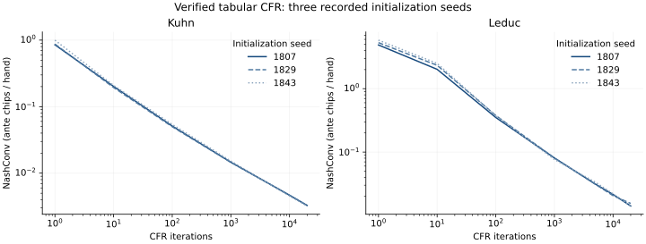
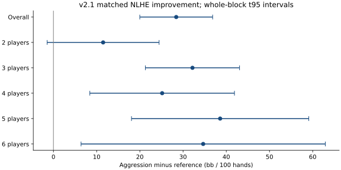

# PokerLab — Learning and Evaluating Poker Strategies with Imperfect Information

Independent research on how a poker AI can learn decisions under hidden information, adapt to observable opponent behavior, and generalize beyond its training population.

PokerLab studies 2–6-player No-Limit Texas Hold'em (NLHE), imitation learning and DAgger, counterfactual regret minimization (CFR), neural regret/average-strategy approximation, opponent modeling, reinforcement learning, strategic aggression and reproducible evaluation. This curated showcase publishes a runnable verified toy-game example, reviewed aggregate results and scientific limitations. It does not expose the private working repository, its history, datasets or model checkpoints.

## Research abstract

Strong performance against a small set of scripted opponents can conceal poor strategic coverage, passivity and evaluation bias. PokerLab separates mathematical verification in finite imperfect-information games from empirical chip-performance testing in multi-player NLHE. Tabular CFR learned low-exploitability Kuhn and Leduc strategies, cross-checked through game-tree best responses, sequence-form linear programs and physical-deal terminal enumeration. Neural approximations revealed coverage, regret-scale and average-fitting failures despite low prediction loss. In NLHE, a conservative imitation reference showed extreme six-player preflop passivity. A frozen, position-aware aggression overlay improved chip performance across a controlled matched suite, while increasing loss risk. A bounded population-PPO experiment did not establish a stronger neural policy. The project emphasizes auditable decisions, legitimate actor information, preserved negative results and independent evaluation conditions.

## Main findings

- **Verified toy-game learning:** after 20,000 iterations across three seeds, Kuhn NashConv was approximately 0.00321–0.00327 and Leduc 0.01410–0.01547. The source, independent evaluators and tests are included.
- **Neural successes have limited scope:** an unchanged small network could reproduce an all-state Leduc average strategy to low exploitability. Missing-state and online regret-learning gates still failed; accurate imitation of a weak mixture did not make it strong.
- **NLHE engineering:** a corrected PokerKit adapter supports complete 2–6-player hands with audited legal actions, chip conservation, side pots and payouts. The full adapter/weights/raw benchmark are not included here.
- **Validated v2.1 aggression:** across 52,800 policy-hands and ten independent paired seed blocks, overall improvement was **+28.42 bb/100**,95% interval **[19.99,36.85]**. Six-player improvement was **+34.66**, interval **[6.40,62.92]**.
- **Behavior and risk:** overall PFR increased **0.17%→7.49%**, six-player PFR **0%→4.36%**. Overall full-stack losses increased **1.24%→1.42%** and losses of at least 10BB **2.35%→2.75%**. More aggression was accepted only with chip-performance and risk guards.
- **Negative RL result:** two PPO seeds trained on 3,072 hands did not establish improvement over both the original reference and fixed aggression policy. Neither neural checkpoint was promoted.

These NLHE results are against controlled simulated opponents, with reset stacks and no rake. They are **not evidence of human-level poker, solved NLHE or profitable real-money gameplay**. Pressure-opponent subgroup gains were individually uncertain. [All results and risk](docs/RESULTS.md) · [Limitations](docs/LIMITATIONS.md).




## Run the public example

Python 3.11 was tested. No poker data, model weights, GPU or private repository is needed.

```bash
python -m venv .venv
# Activate the environment using the command appropriate for your operating system.
python -m pip install -r requirements.txt
python -m pip install --no-deps -e .
python -m pytest
python -m pokerlab_showcase.demo --game both --iterations 2000 --seeds 1807
```

For the reported toy-game budget:

```bash
python -m pokerlab_showcase.demo --game both --iterations 20000 --seeds 1807,1829,1843 --output runs/toy_reproduction.json
```

The public tests check known fixtures, analytical Kuhn equilibria, independent EV/best-response/LP agreement, counterfactual-regret derivatives, bounded convergence and the published NLHE uncertainty calculation. [Reproducibility scope](docs/REPRODUCIBILITY.md). The NLHE policy comparison itself cannot be rerun from this showcase because weights, full environment integration and raw traces are intentionally absent.

## Read the research

[Overview](docs/RESEARCH_OVERVIEW.md) · [Timeline](docs/EXPERIMENTAL_TIMELINE.md) · [Methodology](docs/METHODOLOGY.md) · [Results](docs/RESULTS.md) · [References](docs/REFERENCES.md) · [Publication and rights](NOTICE.md).

## Academic collaboration

I welcome discussion of opponent-model calibration, imperfect-information learning, policy/value approximation, evaluation design and generalization. A useful collaboration would identify a testable failure mode and a controlled experiment, rather than infer poker strength from prediction accuracy or self-play winnings. Public GitHub issues can be used for academic questions or to discuss access/reuse permission; please do not post personal hand histories or credentials.

## Suggested citation

> sharvuncle (2026). *PokerLab — Learning and Evaluating Poker Strategies with Imperfect Information*. Research showcase. https://github.com/sharvuncle/pokerlab-research-showcase. Cite the exact commit used.

No general-use software license has been approved. This repository is source-visible for review and reproducibility; public visibility does not supply a broad reuse license. Dependencies and referenced datasets retain their own rights and licenses. See [NOTICE.md](NOTICE.md).
