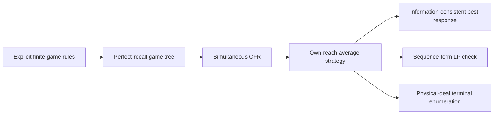

# Research overview

The central question is: how can a poker agent make strong decisions with hidden cards, use only legitimately observable opponent behavior, and generalize beyond strategies encountered during training?

The project has two distinct experimental levels. Finite Kuhn/Leduc games support exact best-response and equilibrium checks. Full NLHE supports matched empirical chip comparisons across2–6 players, but those returns are population-dependent and do not yield an exact exploitability certificate.

The original neural NLHE engineering reference used behavior cloning plus one DAgger round. Conservative teacher labels and greedy classification produced severe six-player passivity. Later work independently verified game rules and payouts, diagnosed neural CFR approximation errors, calibrated public-action opponent predictors, and tested a position-aware value-first aggression module. A bounded population-PPO trial retained terminal-chip rewards and actual masked action likelihoods but did not beat both fixed controls on independent evaluation.

The v2.1 rule overlay is a supported experimental policy variant reusing the preserved neural reference. It is not a newly stronger neural checkpoint or a GTO solver. More frequent raises were insufficient for promotion: overall/six-player chip differences, opponent regressions, catastrophic losses and legality were checked together.

## Public technical example

The included implementation provides full-tree simultaneous vanilla CFR and reach-weighted average strategy, an information-consistent tree best response, an independent sequence-form LP evaluator and separate physical-deal terminal enumeration. Actor policies are indexed only by acting player, own private rank, public board and public action history. Hidden-world enumeration belongs to the evaluator/learning algorithm, not to a playing observation.

These cross-checks share stated rule/information conventions, so they reduce but do not eliminate correlated implementation errors. Known uniform fixtures and analytical Kuhn equilibria provide additional checks.
