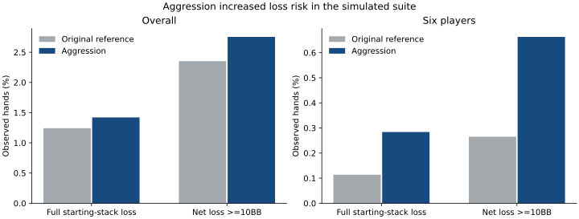

# Results

These are reviewed project measurements. Reduced-game NashConv is exact up to numeric tolerances; NLHE returns are empirical and simulator-dependent.

## Verified reduced games

| Game | Iterations | Seeds | Final NashConv range |
| --- | --- | --- | --- |
| Kuhn | 20,000 | 1807 / 1829 / 1843 | 0.00321282–0.00327287 |
| Leduc | 20,000 | 1807 / 1829 / 1843 | 0.01410100–0.01546643 |

NashConv is twice exploitability under the stated zero-sum convention. Kuhn value is -1/18; Leduc uses the exact variant documented in [Methodology](METHODOLOGY.md).

## v2.1 NLHE matched chip performance

52,800 policy-hands =26,400 matched initial deals evaluated separately under both policies. Ten independent global seed blocks supply the primary t95 intervals.

| Group | Original reference bb/100 | Aggression bb/100 | Paired change | 95% interval |
| --- | --- | --- | --- | --- |
| all | 71.58 | 100.00 | +28.42 | [19.99, 36.85] |
| 2 | 120.51 | 132.02 | +11.51 | [-1.45, 24.46] |
| 3 | 163.64 | 195.81 | +32.18 | [21.28, 43.07] |
| 4 | 46.98 | 72.14 | +25.16 | [8.42, 41.90] |
| 5 | 15.89 | 54.47 | +38.58 | [18.07, 59.09] |
| 6 | 10.89 | 45.55 | +34.66 | [6.40, 62.92] |
| aggressive | 188.44 | 214.77 | +26.33 | [-14.18, 66.85] |
| bluffer | 173.90 | 188.19 | +14.29 | [-18.78, 47.37] |

Pressure-opponent point estimates are positive, but their individual intervals include zero. Promotion did not require a statistically conclusive gain against every category; it used the fixed overall/six-player, subgroup-regression and loss-risk guards.

## Behavioral changes and increased risk

| Group / metric | Original reference | Aggression |
| --- | --- | --- |
| all: PFR per dealt hand | 0.17% | 7.49% |
| all: Fold rate per observed QQ+/AK decision | 27.66% | 7.58% |
| all: Full starting-stack loss rate | 1.24% | 1.42% |
| all: Net loss of at least10BB | 2.35% | 2.75% |
| 6: PFR per dealt hand | 0.00% | 4.36% |
| 6: Fold rate per observed QQ+/AK decision | 67.63% | 13.48% |
| 6: Full starting-stack loss rate | 0.11% | 0.28% |
| 6: Net loss of at least10BB | 0.27% | 0.66% |

All rates retain opportunity counts in the public aggregate fixture. Starting stacks reset each hand. The higher large-loss/stack-loss rates are genuine costs of this policy change; these finite-sample results do not establish future bankroll safety.

## Neural approximation and reinforcement-learning negatives

- All-state Leduc average-policy fitting reached exploitability approximately .00890–.02641, but this was supervised fitting on all known information sets.
- Held-out state coverage and online regret-learning gates failed. Target normalization improved fixed-target reconstruction without establishing a complete strong neural online learner.
- The v2.1 population-PPO run used two seeds and3,072 training hands. On fresh outside-population conditions, neither seed established gains over both the reference and fixed aggression control. No PPO checkpoint was promoted.
- Historical opponent prediction/calibration improvements did not independently establish improved playing strength.

The synthetic solver results are reproducible here. NLHE interval arithmetic is reproducible from the released block differences; the full NLHE games are not, because weights, integration and raw traces are excluded.



Source: reviewed aggregate fixture, v2.1 controlled simulated suite. Risk bars are observed rates; whole-block risk intervals are included in the fixture.
